# Діаграма Ганта — лабораторна робота №3

**Актуалізація, пункт 17 (2026-10-14):** початкові розділи нижче — збережений базовий сценарій **B0** (194 год Human, 16.12.2026). Наприкінці додано окрему повну таблицю та діаграму **S2 із додатковими Gate** (224 год Human, умовно 21.12.2026 13:00). Обидва сценарії не включають неоцінену NF-гілку.

**Плановий базовий графік, не звіт про виконання.** Джерело: [implementation-plan.md](implementation-plan.md), 45 D-тікетів. Умовний старт: **2026-10-19, 09:00**. Розрахований кінець резервованого графіка: **2026-12-16 13:00 (Europe/Kyiv)**. Це умовна дата для відомих робіт і зарезервованих завершальних сесій; **дата повного приймання залишається невизначеною через невідомі NF Test/Feature**.

## Базовий сценарій і календар

- Робочі дні — понеділок–п’ятниця, 09:00–17:00, по 8 годин. Субота й неділя виключені. Святкові дні, відпустки й обідня перерва окремо не моделюються. Усі дати — локальні Europe/Kyiv; календарне переведення годин не змінює 8-годинний робочий день.
- Для активної оцінки взято середину інтервалу з плану та округлено вгору до 0,25 робочого дня (2 години). Це помірний базовий сценарій із невеликим округленням, а не оптимістична нижня межа.
- З активної тривалості звичайної AI/Shared-задачі **0,5 дня** відведено одному Human-рецензенту — верхню межу наявної оцінки перегляду. Для D-40/D-41 Human має **0,75 дня**, середину відповідного інтервалу. Для Human-задач D-11/D-42/D-44 вся активна тривалість належить людині. Решта — одному з двох потоків AI. Людський час уже включений, його не додано вдруге.
- D-45 має 0,5 дня Human і 0 днів AI: таблиця вже підготовлена в чернетці, графік резервує її перевірку та людське рішення, не вважаючи його виконаним.
- Після підготовки кожного Addendum і перед кожним Gate закладено **1 робочий день** очікування погодження; перед Validation — **1,5 робочого дня** узгодження сесії. Очікування не займає AI чи Human. Додаткова черга до зайнятого рецензента обчислена окремо. Для інших задач штучне очікування не додається.
- Графік допускає незалежну роботу в AI-1 та AI-2, але всі перегляди й рішення проходять послідовно через одного Human. Змістовне погодження очікується за один цикл; завершення резервованого очікування **не є автоматичним схваленням**.
- Для простоти виконання залежності, які в плані блокують лише закриття, тут консервативно завершуються **до початку** залежної задачі. Уточнення також плануються до відповідних повних пакетів. Це допустимий порядок, а не нове правило SRS. Незалежні роботи не чекають усіх Addendum глобально; D-11 залежить лише від D-01/D-45.
- Інтеграційні зв’язки «І» перевіряються в D-40 і не створюють зворотних блокувань. Розклад побудовано пошуком вільних робочих слотів за залежностями й пріоритетом основного ланцюга доступ → каталог → графік → запис. Це здійсненний ресурсний графік, не доказ найкоротшого строку.

## NF-гілка і статус завершальних дат

**D-41, D-42, D-43, D-44 позначені «УМОВНО».** Їхні відрізки — резерв ресурсу, а не твердження про готовність передумов. Для D-41 додатково обрано консервативний плановий зв’язок після D-40; ранні перевірки могли б перекриватися, але тут такого виграшу не враховано.

D-08–D-10 мають завершитися рішеннями людини: погодити, відхилити чи відкласти конкретні пропозиції. Їхні дати не означають, що невідомі NF Test/Feature реалізовано. Оскільки цих задач та оцінок ще немає, їх не показано нульовою тривалістю і не включено до 45 D-тікетів як вигадані роботи. Відома підготовка/облік статусів D-41 може виконуватися, але його повна верифікація та залежне повне приймання залишаються заблокованими без потрібних доказів.

Отже, для використання завершальних резервів у повному обсязі спочатку треба деталізувати й ресурсно перепланувати NF-гілку. Не можна припустити, що вона непомітно виконувалася третім потоком або до старту. Якщо доказів до резервованих дат немає, D-42 допускає лише перегляд готової частини, а D-44 — фіксацію блокування/повернення на доопрацювання, **не PASS всього погодженого обсягу**. Погоджені основи захисту даних, адаптивності та браузерної сумісності не вилучаються.

Якщо буде погоджено REQ-NF-011 із поточною місячною методикою, потрібне окреме спостереження за календарний місяць після готовності середовища. Воно не вміщується в активні 3 дні D-41. Початок і закінчення цього вікна поки не визначені; резерв кінцевих сесій має бути пересунуто. Непогоджений поріг не стає обов’язковим через побудову графіка.

## Mermaid Gantt

Рядки груповано за ресурсом, тому один D-тікет може мати AI-відрізок, очікування та Human-відрізок. Позначка «УМОВНО» означає резерв, не виконану задачу. На діаграмі немає статусу `done`. Явні дати задають календарну оболонку роботи; нічні години всередині багатоденного відрізка не є роботою. Точний облік ведеться 2-годинними слотами 09:00–17:00; таблиця нижче розділяє активний час і очікування.

```mermaid
gantt
    title Лабораторна 3 — два потоки AI та один Human
    dateFormat YYYY-MM-DD HH:mm
    axisFormat %d.%m
    excludes weekends
    todayMarker off
    section AI-1
    D-01 підготовка :ai1d01, 2026-10-19 09:00, 2026-10-19 11:00
    D-02 підготовка :ai1d02, 2026-10-19 11:00, 2026-10-19 13:00
    D-03 підготовка :ai1d03, 2026-10-19 13:00, 2026-10-19 15:00
    D-04 підготовка :ai1d04, 2026-10-19 15:00, 2026-10-19 17:00
    D-06 підготовка :ai1d06, 2026-10-20 09:00, 2026-10-20 15:00
    D-09 підготовка :ai1d09, 2026-10-20 15:00, 2026-10-21 11:00
    D-14 підготовка :ai1d14, 2026-10-27 13:00, 2026-10-27 15:00
    D-18 підготовка :ai1d18, 2026-10-27 15:00, 2026-10-27 17:00
    D-24 підготовка :ai1d24, 2026-10-28 09:00, 2026-10-28 17:00
    D-15 підготовка :ai1d15, 2026-10-29 09:00, 2026-10-29 17:00
    D-30 підготовка :ai1d30, 2026-10-30 09:00, 2026-10-30 11:00
    D-25 підготовка :ai1d25, 2026-10-30 11:00, 2026-11-03 11:00
    D-34 підготовка :ai1d34, 2026-11-03 11:00, 2026-11-03 13:00
    D-12 підготовка :ai1d12, 2026-11-03 13:00, 2026-11-03 15:00
    D-19 підготовка :ai1d19, 2026-11-06 11:00, 2026-11-09 11:00
    D-13 підготовка :ai1d13, 2026-11-09 11:00, 2026-11-10 11:00
    D-23 підготовка :ai1d23, 2026-11-11 11:00, 2026-11-13 11:00
    D-27 підготовка :ai1d27, 2026-11-13 15:00, 2026-11-17 15:00
    D-29 підготовка :ai1d29, 2026-11-18 11:00, 2026-11-19 11:00
    D-33 підготовка :ai1d33, 2026-11-19 15:00, 2026-11-23 15:00
    D-37 підготовка :ai1d37, 2026-11-24 11:00, 2026-11-25 11:00
    D-39 підготовка :ai1d39, 2026-11-25 15:00, 2026-11-27 15:00
    D-40 підготовка :ai1d40, 2026-11-30 11:00, 2026-12-02 13:00
    D-41 УМОВНО підготовка :ai1d41, 2026-12-03 11:00, 2026-12-07 13:00
    D-43 УМОВНО підготовка :ai1d43, 2026-12-11 11:00, 2026-12-14 11:00
    section AI-2
    D-07 підготовка :ai2d07, 2026-10-19 09:00, 2026-10-19 15:00
    D-05 підготовка :ai2d05, 2026-10-19 15:00, 2026-10-19 17:00
    D-08 підготовка :ai2d08, 2026-10-20 09:00, 2026-10-20 17:00
    D-10 підготовка :ai2d10, 2026-10-21 09:00, 2026-10-21 17:00
    D-16 підготовка :ai2d16, 2026-10-27 13:00, 2026-10-27 15:00
    D-20 підготовка :ai2d20, 2026-10-27 15:00, 2026-10-27 17:00
    D-22 підготовка :ai2d22, 2026-10-28 09:00, 2026-10-28 17:00
    D-26 підготовка :ai2d26, 2026-10-29 09:00, 2026-10-29 11:00
    D-28 підготовка :ai2d28, 2026-10-29 11:00, 2026-10-29 13:00
    D-32 підготовка :ai2d32, 2026-10-29 13:00, 2026-10-30 13:00
    D-36 підготовка :ai2d36, 2026-10-30 13:00, 2026-10-30 15:00
    D-38 підготовка :ai2d38, 2026-10-30 15:00, 2026-11-02 15:00
    D-17 підготовка :ai2d17, 2026-11-02 15:00, 2026-11-03 15:00
    D-21 підготовка :ai2d21, 2026-11-09 15:00, 2026-11-10 15:00
    D-31 підготовка :ai2d31, 2026-11-19 15:00, 2026-11-20 15:00
    D-35 підготовка :ai2d35, 2026-11-24 11:00, 2026-11-25 11:00
    section Human
    D-01 Specification :humand01, 2026-10-19 11:00, 2026-10-19 15:00
    D-07 Specification :humand07, 2026-10-19 15:00, 2026-10-20 11:00
    D-02 Addendum :humand02, 2026-10-20 13:00, 2026-10-20 17:00
    D-03 Addendum :humand03, 2026-10-21 09:00, 2026-10-21 13:00
    D-45 Documentation :humand45, 2026-10-21 13:00, 2026-10-21 17:00
    D-04 Addendum :humand04, 2026-10-22 09:00, 2026-10-22 13:00
    D-05 Addendum :humand05, 2026-10-22 13:00, 2026-10-22 17:00
    D-06 Addendum :humand06, 2026-10-23 09:00, 2026-10-23 13:00
    D-08 Addendum :humand08, 2026-10-23 13:00, 2026-10-23 17:00
    D-09 Addendum :humand09, 2026-10-26 09:00, 2026-10-26 13:00
    D-10 Addendum :humand10, 2026-10-26 13:00, 2026-10-26 17:00
    D-11 Gate :humand11, 2026-10-27 09:00, 2026-10-27 13:00
    D-14 Test :humand14, 2026-10-27 15:00, 2026-10-28 11:00
    D-16 Test :humand16, 2026-10-28 11:00, 2026-10-28 15:00
    D-18 Test :humand18, 2026-10-28 15:00, 2026-10-29 11:00
    D-20 Test :humand20, 2026-10-29 11:00, 2026-10-29 15:00
    D-24 Test :humand24, 2026-10-29 15:00, 2026-10-30 11:00
    D-22 Test :humand22, 2026-10-30 11:00, 2026-10-30 15:00
    D-15 Feature :humand15, 2026-10-30 15:00, 2026-11-02 11:00
    D-26 Test :humand26, 2026-11-02 11:00, 2026-11-02 15:00
    D-28 Test :humand28, 2026-11-02 15:00, 2026-11-03 11:00
    D-32 Test :humand32, 2026-11-03 11:00, 2026-11-03 15:00
    D-30 Test :humand30, 2026-11-03 15:00, 2026-11-04 11:00
    D-25 Feature :humand25, 2026-11-04 11:00, 2026-11-04 15:00
    D-36 Test :humand36, 2026-11-04 15:00, 2026-11-05 11:00
    D-38 Test :humand38, 2026-11-05 11:00, 2026-11-05 15:00
    D-17 Feature :humand17, 2026-11-05 15:00, 2026-11-06 11:00
    D-34 Test :humand34, 2026-11-06 11:00, 2026-11-06 15:00
    D-12 Test :humand12, 2026-11-06 15:00, 2026-11-09 11:00
    D-19 Feature :humand19, 2026-11-09 11:00, 2026-11-09 15:00
    D-13 Feature :humand13, 2026-11-10 11:00, 2026-11-10 15:00
    D-21 Feature :humand21, 2026-11-10 15:00, 2026-11-11 11:00
    D-23 Feature :humand23, 2026-11-13 11:00, 2026-11-13 15:00
    D-27 Feature :humand27, 2026-11-17 15:00, 2026-11-18 11:00
    D-29 Feature :humand29, 2026-11-19 11:00, 2026-11-19 15:00
    D-31 Feature :humand31, 2026-11-20 15:00, 2026-11-23 11:00
    D-33 Feature :humand33, 2026-11-23 15:00, 2026-11-24 11:00
    D-37 Feature :humand37, 2026-11-25 11:00, 2026-11-25 15:00
    D-35 Feature :humand35, 2026-11-25 15:00, 2026-11-26 11:00
    D-39 Feature :humand39, 2026-11-27 15:00, 2026-11-30 11:00
    D-40 Verification :humand40, 2026-12-02 13:00, 2026-12-03 11:00
    D-41 УМОВНО Verification :humand41, 2026-12-07 13:00, 2026-12-08 11:00
    D-42 УМОВНО Validation :humand42, 2026-12-09 15:00, 2026-12-11 11:00
    D-43 УМОВНО Documentation :humand43, 2026-12-14 11:00, 2026-12-14 15:00
    D-44 УМОВНО Gate :humand44, 2026-12-15 15:00, 2026-12-16 13:00
    section Очікування без зайнятості ресурсу
    D-02 очікування :w02, 2026-10-19 13:00, 2026-10-20 13:00
    D-03 очікування :w03, 2026-10-19 15:00, 2026-10-20 15:00
    D-04 очікування :w04, 2026-10-20 09:00, 2026-10-20 17:00
    D-05 очікування :w05, 2026-10-20 09:00, 2026-10-20 17:00
    D-06 очікування :w06, 2026-10-20 15:00, 2026-10-21 15:00
    D-08 очікування :w08, 2026-10-21 09:00, 2026-10-21 17:00
    D-09 очікування :w09, 2026-10-21 11:00, 2026-10-22 11:00
    D-10 очікування :w10, 2026-10-22 09:00, 2026-10-22 17:00
    D-11 очікування :w11, 2026-10-22 09:00, 2026-10-22 17:00
    D-42 очікування УМОВНО :w42, 2026-12-08 11:00, 2026-12-09 15:00
    D-44 очікування УМОВНО :w44, 2026-12-14 15:00, 2026-12-15 15:00
```

## Планові дати всіх 45 тікетів

Початок задачі включає резерв очікування для Human-only Gate/Validation. Завершення — кінець Human-сесії; у D-41–D-44 це кінець резерву, а не гарантоване виконання. Дати без часу в колонках початку/кінця деталізовано в ресурсних вікнах. «Пауза/черга» — робочі дні між AI (або готовністю Human-задачі) та Human-сесією; вихідні й ночі не рахуються.

| Тікет / тип / виконавець | Початок | Кінець | Активно, дні (AI + Human) | AI-потік і вікно | Human-вікно | Пауза + черга, дні | Передумови цього графіка |
| --- | --- | --- | --- | --- | --- | --- | --- |
| D-01 — Перевірити межі та покриття плану робіт Specification / Shared | 2026-10-19 | 2026-10-19 | 0,75 (0,25 + 0,5) | AI-1: 2026-10-19 09:00 → 2026-10-19 11:00 | 2026-10-19 11:00 → 2026-10-19 15:00 | 0 + 0 | — |
| D-02 — Уточнити відлік горизонту бронювання Addendum / Shared | 2026-10-19 | 2026-10-20 | 0,75 (0,25 + 0,5) | AI-1: 2026-10-19 11:00 → 2026-10-19 13:00 | 2026-10-20 13:00 → 2026-10-20 17:00 | 1 + 0 | — |
| D-03 — Уточнити сітку початків та найближчий час адміністратора Addendum / Shared | 2026-10-19 | 2026-10-21 | 0,75 (0,25 + 0,5) | AI-1: 2026-10-19 13:00 → 2026-10-19 15:00 | 2026-10-21 09:00 → 2026-10-21 13:00 | 1 + 0,25 | — |
| D-04 — Уточнити нагадування після перенесення запису, створеного менш ніж за добу Addendum / Shared | 2026-10-19 | 2026-10-22 | 0,75 (0,25 + 0,5) | AI-1: 2026-10-19 15:00 → 2026-10-19 17:00 | 2026-10-22 09:00 → 2026-10-22 13:00 | 1 + 1 | — |
| D-05 — Уточнити негативне приймання несумісної пари послуга/майстер при зміні Addendum / Shared | 2026-10-19 | 2026-10-22 | 0,75 (0,25 + 0,5) | AI-2: 2026-10-19 15:00 → 2026-10-19 17:00 | 2026-10-22 13:00 → 2026-10-22 17:00 | 1 + 1,5 | — |
| D-06 — Уточнити історію при видаленні та зміни записів із деактивованими сутностями Addendum / Shared | 2026-10-20 | 2026-10-23 | 1,25 (0,75 + 0,5) | AI-1: 2026-10-20 09:00 → 2026-10-20 15:00 | 2026-10-23 09:00 → 2026-10-23 13:00 | 1 + 1,25 | — |
| D-07 — Зафіксувати межі деталізації доступу та листів Specification / Shared | 2026-10-19 | 2026-10-20 | 1,25 (0,75 + 0,5) | AI-2: 2026-10-19 09:00 → 2026-10-19 15:00 | 2026-10-19 15:00 → 2026-10-20 11:00 | 0 + 0 | — |
| D-08 — Погодити продуктивність, надійність і доступність сервісу Addendum / Shared | 2026-10-20 | 2026-10-23 | 1,5 (1 + 0,5) | AI-2: 2026-10-20 09:00 → 2026-10-20 17:00 | 2026-10-23 13:00 → 2026-10-23 17:00 | 1 + 1,5 | — |
| D-09 — Погодити конкретні критерії захисту персональних даних Addendum / Shared | 2026-10-20 | 2026-10-26 | 1 (0,5 + 0,5) | AI-1: 2026-10-20 15:00 → 2026-10-21 11:00 | 2026-10-26 09:00 → 2026-10-26 13:00 | 1 + 1,75 | — |
| D-10 — Погодити адаптивність, браузери та доступність інтерфейсу Addendum / Shared | 2026-10-21 | 2026-10-26 | 1,5 (1 + 0,5) | AI-2: 2026-10-21 09:00 → 2026-10-21 17:00 | 2026-10-26 13:00 → 2026-10-26 17:00 | 1 + 1,5 | — |
| D-11 — Перевірити готовність погоджених пакетів до TDD Gate / Human | 2026-10-22 | 2026-10-27 | 0,5 (0 + 0,5) | — | 2026-10-27 09:00 → 2026-10-27 13:00 | 1 + 2 | D-01, D-45 |
| D-12 — Тести: Публічний каталог і майстри Test / AI | 2026-11-03 | 2026-11-09 | 0,75 (0,25 + 0,5) | AI-1: 2026-11-03 13:00 → 2026-11-03 15:00 | 2026-11-06 15:00 → 2026-11-09 11:00 | 0 + 3 | D-11 |
| D-13 — Публічний каталог і майстри Feature / AI | 2026-11-09 | 2026-11-10 | 1,5 (1 + 0,5) | AI-1: 2026-11-09 11:00 → 2026-11-10 11:00 | 2026-11-10 11:00 → 2026-11-10 15:00 | 0 + 0 | D-12 |
| D-14 — Тести: Реєстрація, вхід і захист паролів Test / AI | 2026-10-27 | 2026-10-28 | 0,75 (0,25 + 0,5) | AI-1: 2026-10-27 13:00 → 2026-10-27 15:00 | 2026-10-27 15:00 → 2026-10-28 11:00 | 0 + 0 | D-07, D-11 |
| D-15 — Реєстрація, вхід і захист паролів Feature / AI | 2026-10-29 | 2026-11-02 | 1,5 (1 + 0,5) | AI-1: 2026-10-29 09:00 → 2026-10-29 17:00 | 2026-10-30 15:00 → 2026-11-02 11:00 | 0 + 0,75 | D-07, D-14 |
| D-16 — Тести: Ролі та доступ до власних записів Test / AI | 2026-10-27 | 2026-10-28 | 0,75 (0,25 + 0,5) | AI-2: 2026-10-27 13:00 → 2026-10-27 15:00 | 2026-10-28 11:00 → 2026-10-28 15:00 | 0 + 0,5 | D-07, D-11 |
| D-17 — Ролі та доступ до власних записів Feature / AI | 2026-11-02 | 2026-11-06 | 1,5 (1 + 0,5) | AI-2: 2026-11-02 15:00 → 2026-11-03 15:00 | 2026-11-05 15:00 → 2026-11-06 11:00 | 0 + 2 | D-07, D-15, D-16 |
| D-18 — Тести: Керування послугами та майстрами Test / AI | 2026-10-27 | 2026-10-29 | 0,75 (0,25 + 0,5) | AI-1: 2026-10-27 15:00 → 2026-10-27 17:00 | 2026-10-28 15:00 → 2026-10-29 11:00 | 0 + 0,75 | D-11 |
| D-19 — Керування послугами та майстрами Feature / AI | 2026-11-06 | 2026-11-09 | 1,5 (1 + 0,5) | AI-1: 2026-11-06 11:00 → 2026-11-09 11:00 | 2026-11-09 11:00 → 2026-11-09 15:00 | 0 + 0 | D-17, D-18 |
| D-20 — Тести: Тижневий графік і винятки Test / AI | 2026-10-27 | 2026-10-29 | 0,75 (0,25 + 0,5) | AI-2: 2026-10-27 15:00 → 2026-10-27 17:00 | 2026-10-29 11:00 → 2026-10-29 15:00 | 0 + 1,25 | D-11 |
| D-21 — Тижневий графік і винятки Feature / AI | 2026-11-09 | 2026-11-11 | 1,5 (1 + 0,5) | AI-2: 2026-11-09 15:00 → 2026-11-10 15:00 | 2026-11-10 15:00 → 2026-11-11 11:00 | 0 + 0 | D-19, D-20 |
| D-22 — Тести: Слоти та календарні обмеження Test / AI | 2026-10-28 | 2026-10-30 | 1,5 (1 + 0,5) | AI-2: 2026-10-28 09:00 → 2026-10-28 17:00 | 2026-10-30 11:00 → 2026-10-30 15:00 | 0 + 1,25 | D-02, D-03, D-11 |
| D-23 — Слоти та календарні обмеження Feature / AI | 2026-11-11 | 2026-11-13 | 2,5 (2 + 0,5) | AI-1: 2026-11-11 11:00 → 2026-11-13 11:00 | 2026-11-13 11:00 → 2026-11-13 15:00 | 0 + 0 | D-02, D-03, D-19, D-21, D-22, D-25 |
| D-24 — Тести: Часові конфлікти та конкурентне збереження Test / AI | 2026-10-28 | 2026-10-30 | 1,5 (1 + 0,5) | AI-1: 2026-10-28 09:00 → 2026-10-28 17:00 | 2026-10-29 15:00 → 2026-10-30 11:00 | 0 + 0,75 | D-11 |
| D-25 — Часові конфлікти та конкурентне збереження Feature / AI | 2026-10-30 | 2026-11-04 | 2,5 (2 + 0,5) | AI-1: 2026-10-30 11:00 → 2026-11-03 11:00 | 2026-11-04 11:00 → 2026-11-04 15:00 | 0 + 1 | D-24 |
| D-26 — Тести: Створення та фіксація даних запису Test / AI | 2026-10-29 | 2026-11-02 | 0,75 (0,25 + 0,5) | AI-2: 2026-10-29 09:00 → 2026-10-29 11:00 | 2026-11-02 11:00 → 2026-11-02 15:00 | 0 + 2 | D-02, D-03, D-11 |
| D-27 — Створення та фіксація даних запису Feature / AI | 2026-11-13 | 2026-11-18 | 2,5 (2 + 0,5) | AI-1: 2026-11-13 15:00 → 2026-11-17 15:00 | 2026-11-17 15:00 → 2026-11-18 11:00 | 0 + 0 | D-02, D-03, D-17, D-19, D-23, D-25, D-26 |
| D-28 — Тести: Актуальні записи, деталі та історія Test / AI | 2026-10-29 | 2026-11-03 | 0,75 (0,25 + 0,5) | AI-2: 2026-10-29 11:00 → 2026-10-29 13:00 | 2026-11-02 15:00 → 2026-11-03 11:00 | 0 + 2,25 | D-06, D-11 |
| D-29 — Актуальні записи, деталі та історія Feature / AI | 2026-11-18 | 2026-11-19 | 1,5 (1 + 0,5) | AI-1: 2026-11-18 11:00 → 2026-11-19 11:00 | 2026-11-19 11:00 → 2026-11-19 15:00 | 0 + 0 | D-06, D-17, D-27, D-28 |
| D-30 — Тести: Скасування та заборони редагування Test / AI | 2026-10-30 | 2026-11-04 | 0,75 (0,25 + 0,5) | AI-1: 2026-10-30 09:00 → 2026-10-30 11:00 | 2026-11-03 15:00 → 2026-11-04 11:00 | 0 + 2,5 | D-11 |
| D-31 — Скасування та заборони редагування Feature / AI | 2026-11-19 | 2026-11-23 | 1,5 (1 + 0,5) | AI-2: 2026-11-19 15:00 → 2026-11-20 15:00 | 2026-11-20 15:00 → 2026-11-23 11:00 | 0 + 0 | D-17, D-29, D-30 |
| D-32 — Тести: Адміністративна зміна та перенесення Test / AI | 2026-10-29 | 2026-11-03 | 1,5 (1 + 0,5) | AI-2: 2026-10-29 13:00 → 2026-10-30 13:00 | 2026-11-03 11:00 → 2026-11-03 15:00 | 0 + 1,75 | D-02, D-03, D-05, D-06, D-11 |
| D-33 — Адміністративна зміна та перенесення Feature / AI | 2026-11-19 | 2026-11-24 | 2,5 (2 + 0,5) | AI-1: 2026-11-19 15:00 → 2026-11-23 15:00 | 2026-11-23 15:00 → 2026-11-24 11:00 | 0 + 0 | D-02, D-03, D-05, D-06, D-17, D-23, D-25, D-29, D-32 |
| D-34 — Тести: Захист графіка та життєвий цикл послуг і майстрів Test / AI | 2026-11-03 | 2026-11-06 | 0,75 (0,25 + 0,5) | AI-1: 2026-11-03 11:00 → 2026-11-03 13:00 | 2026-11-06 11:00 → 2026-11-06 15:00 | 0 + 2,75 | D-06, D-11 |
| D-35 — Захист графіка та життєвий цикл послуг і майстрів Feature / AI | 2026-11-24 | 2026-11-26 | 1,5 (1 + 0,5) | AI-2: 2026-11-24 11:00 → 2026-11-25 11:00 | 2026-11-25 15:00 → 2026-11-26 11:00 | 0 + 0,5 | D-06, D-19, D-21, D-27, D-31, D-33, D-34 |
| D-36 — Тести: Email про створення, зміну й скасування Test / AI | 2026-10-30 | 2026-11-05 | 0,75 (0,25 + 0,5) | AI-2: 2026-10-30 13:00 → 2026-10-30 15:00 | 2026-11-04 15:00 → 2026-11-05 11:00 | 0 + 3 | D-07, D-11 |
| D-37 — Email про створення, зміну й скасування Feature / AI | 2026-11-24 | 2026-11-25 | 1,5 (1 + 0,5) | AI-1: 2026-11-24 11:00 → 2026-11-25 11:00 | 2026-11-25 11:00 → 2026-11-25 15:00 | 0 + 0 | D-07, D-27, D-31, D-33, D-36 |
| D-38 — Тести: Нагадування та їх перепланування Test / AI | 2026-10-30 | 2026-11-05 | 1,5 (1 + 0,5) | AI-2: 2026-10-30 15:00 → 2026-11-02 15:00 | 2026-11-05 11:00 → 2026-11-05 15:00 | 0 + 2,5 | D-04, D-07, D-11 |
| D-39 — Нагадування та їх перепланування Feature / AI | 2026-11-25 | 2026-11-30 | 2,5 (2 + 0,5) | AI-1: 2026-11-25 15:00 → 2026-11-27 15:00 | 2026-11-27 15:00 → 2026-11-30 11:00 | 0 + 0 | D-04, D-07, D-27, D-31, D-33, D-37, D-38 |
| D-40 — Верифікувати реалізацію та докази TDD Verification / Shared | 2026-11-30 | 2026-12-03 | 3 (2,25 + 0,75) | AI-1: 2026-11-30 11:00 → 2026-12-02 13:00 | 2026-12-02 13:00 → 2026-12-03 11:00 | 0 + 0 | D-02, D-03, D-04, D-05, D-06, D-07, D-13, D-15, D-17, D-19, D-21, D-23, D-25, D-27, D-29, D-31, D-33, D-35, D-37, D-39 |
| D-41 — Верифікувати лише погоджені критерії якості Verification / Shared **УМОВНО** | 2026-12-03 | 2026-12-08 | 3 (2,25 + 0,75) | AI-1: 2026-12-03 11:00 → 2026-12-07 13:00 | 2026-12-07 13:00 → 2026-12-08 11:00 | 0 + 0 | D-08, D-09, D-10, D-40; невідомі NF Test/Feature — BLOCKED |
| D-42 — Провести людське приймання клієнтських і адміністративних сценаріїв Validation / Human **УМОВНО** | 2026-12-08 | 2026-12-11 | 1,5 (0 + 1,5) | — | 2026-12-09 15:00 → 2026-12-11 11:00 | 1,5 + 0 | D-40, D-41 |
| D-43 — Документувати реалізацію та остаточно звірити її простежуваність Documentation / AI **УМОВНО** | 2026-12-11 | 2026-12-14 | 1,5 (1 + 0,5) | AI-1: 2026-12-11 11:00 → 2026-12-14 11:00 | 2026-12-14 11:00 → 2026-12-14 15:00 | 0 + 0 | D-40, D-41, D-42, D-45 |
| D-44 — Ухвалити рішення про завершення погодженого SDD-циклу Gate / Human **УМОВНО** | 2026-12-14 | 2026-12-16 | 0,75 (0 + 0,75) | — | 2026-12-15 15:00 → 2026-12-16 13:00 | 1 + 0 | D-40, D-41, D-42, D-43 |
| D-45 — Заповнити поточну робочу матрицю декомпозиції Documentation / Shared | 2026-10-19 | 2026-10-21 | 0,5 (0 + 0,5) | — | 2026-10-21 13:00 → 2026-10-21 17:00 | 0 + 1,75 | D-01 |

## Перевірка ресурсу та залежностей

- У таблиці **45 унікальних D-ID: D-01–D-45**; типи, основні виконавці та інтервали оцінок звірено з implementation-plan.md.
- Сумарний активний бюджет бази: **60,5 робочого дня**, із них **36,25 AI** та **24,25 Human**. Це сума завантаження, не календарний строк. Для умовних завершальних задач бюджет є резервом.
- Максимум одночасно зайнятих потоків AI: **2 із 2**; максимум одночасних Human-сесій: **1 із 1**. Накладань усередині AI-1, AI-2 та Human немає; перевірено кожен 2-годинний робочий слот, включно з умовними резервами.
- Кожна відома передумова завершена в розрахунку не пізніше початку залежної задачі; власний Test передує Feature. У графі відомих D-тікетів циклів немає. Невідомі передумови NF не оголошуються перевіреними або виконаними.
- Для всіх Addendum/Gate витримано 1 робочий день паузи; для Validation — 1,5 дня. Human-сесії починаються після цих пауз і можливого очікування в черзі. Самі паузи не споживають виконавців.
- Вихідні не мають жодного робочого слота; ночі не включені до активних оцінок. Усі оцінки та частки Human лежать усередині інтервалів плану.

Розрахункова дата завершення резервованої бази — **2026-12-16 13:00**. Її обмежують фактична швидкість погоджень, один рецензент, припущення одного циклу невеликих виправлень та неповна NF-гілка. Після деталізації NF або додаткової ітерації приймання графік треба перебудувати; дати D-41–D-44 не є обіцянкою повного PASS.

Це перевірка календарного документа, не виконання тестів продукту чи приймання. SRS, файли spec/, декомпозицію й план реалізації не змінено. Issues не створено, функціональність не реалізовано.

<!-- LAB3-GATES-SCENARIO -->

## Сценарій S2 — додаткові Gate (пункт 17)

Базовий сценарій B0 вище збережено. S2 застосовує погоджений користувачем порядок із [additional-gates.md](additional-gates.md). Погоджено планування контрольних точок, не їх проходження. Умовний кінець — **21.12.2026 13:00**, 224 години Human. Невідомі NF-роботи й підготовка пакета G-R4 не включені; D-41–D-44 та G-R4 залишаються умовними резервами.

G-R4 стоїть у Human-черзі після D-11 і перед D-14:H, має 4 години H та 1 робочий день W після D-10. Готовність NF-пакета наприкінці D-10 — припущення сценарію. G-R4 → D-41 є логічною передумовою; G-R4 → D-14:H є лише ресурсним порядком. G-R1/G-R2 вбудовано без додаткового часу; G-R3 додає 2 години D-40:H, G-R6 — по 2 години D-41:H і D-44:H. Десять G-R5 займають понеділки 09:00–11:00; H-сесія може перериватися на цей слот. Ночі/вихідні всередині оболонки вікна не є роботою.

| D-ID | AI-потік і вікно S2 | Human-вікно S2 | Активно AI/H, год | W / Q, роб. дні |
| --- | --- | --- | --- | --- |
| D-01 | AI-1: 2026-10-19 09:00 → 2026-10-19 11:00 | 2026-10-19 11:00 → 2026-10-19 15:00 | 2 / 4 | 0 / 0 |
| D-02 | AI-1: 2026-10-19 11:00 → 2026-10-19 13:00 | 2026-10-20 13:00 → 2026-10-20 17:00 | 2 / 4 | 1 / 0 |
| D-03 | AI-1: 2026-10-19 13:00 → 2026-10-19 15:00 | 2026-10-21 09:00 → 2026-10-21 13:00 | 2 / 4 | 1 / 0,25 |
| D-04 | AI-1: 2026-10-19 15:00 → 2026-10-19 17:00 | 2026-10-22 09:00 → 2026-10-22 13:00 | 2 / 4 | 1 / 1 |
| D-05 | AI-2: 2026-10-19 15:00 → 2026-10-19 17:00 | 2026-10-22 13:00 → 2026-10-22 17:00 | 2 / 4 | 1 / 1,5 |
| D-06 | AI-1: 2026-10-20 09:00 → 2026-10-20 15:00 | 2026-10-23 09:00 → 2026-10-23 13:00 | 6 / 4 | 1 / 1,25 |
| D-07 | AI-2: 2026-10-19 09:00 → 2026-10-19 15:00 | 2026-10-19 15:00 → 2026-10-20 11:00 | 6 / 4 | 0 / 0 |
| D-08 | AI-2: 2026-10-20 09:00 → 2026-10-20 17:00 | 2026-10-23 13:00 → 2026-10-23 17:00 | 8 / 4 | 1 / 1,5 |
| D-09 | AI-1: 2026-10-20 15:00 → 2026-10-21 11:00 | 2026-10-26 11:00 → 2026-10-26 15:00 | 4 / 4 | 1 / 2 |
| D-10 | AI-2: 2026-10-21 09:00 → 2026-10-21 17:00 | 2026-10-26 15:00 → 2026-10-27 11:00 | 8 / 4 | 1 / 1,75 |
| D-11 | — | 2026-10-27 11:00 → 2026-10-27 15:00 | 0 / 4 | 1 / 2,25 |
| D-12 | AI-1: 2026-11-04 15:00 → 2026-11-04 17:00 | 2026-11-10 11:00 → 2026-11-10 15:00 | 2 / 4 | 0 / 3,25 |
| D-13 | AI-1: 2026-11-10 15:00 → 2026-11-11 15:00 | 2026-11-11 15:00 → 2026-11-12 11:00 | 8 / 4 | 0 / 0 |
| D-14 | AI-1: 2026-10-27 15:00 → 2026-10-27 17:00 | 2026-10-28 15:00 → 2026-10-29 11:00 | 2 / 4 | 0 / 0,75 |
| D-15 | AI-1: 2026-10-29 11:00 → 2026-10-30 11:00 | 2026-11-03 09:00 → 2026-11-03 13:00 | 8 / 4 | 0 / 1,75 |
| D-16 | AI-2: 2026-10-27 15:00 → 2026-10-27 17:00 | 2026-10-29 11:00 → 2026-10-29 15:00 | 2 / 4 | 0 / 1,25 |
| D-17 | AI-2: 2026-11-03 13:00 → 2026-11-04 13:00 | 2026-11-09 11:00 → 2026-11-09 15:00 | 8 / 4 | 0 / 2,75 |
| D-18 | AI-1: 2026-10-28 09:00 → 2026-10-28 11:00 | 2026-10-29 15:00 → 2026-10-30 11:00 | 2 / 4 | 0 / 1,5 |
| D-19 | AI-1: 2026-11-09 15:00 → 2026-11-10 15:00 | 2026-11-10 15:00 → 2026-11-11 11:00 | 8 / 4 | 0 / 0 |
| D-20 | AI-2: 2026-10-28 09:00 → 2026-10-28 11:00 | 2026-10-30 11:00 → 2026-10-30 15:00 | 2 / 4 | 0 / 2 |
| D-21 | AI-2: 2026-11-11 11:00 → 2026-11-12 11:00 | 2026-11-12 11:00 → 2026-11-12 15:00 | 8 / 4 | 0 / 0 |
| D-22 | AI-2: 2026-10-28 11:00 → 2026-10-29 11:00 | 2026-11-02 13:00 → 2026-11-02 17:00 | 8 / 4 | 0 / 2,25 |
| D-23 | AI-1: 2026-11-12 15:00 → 2026-11-16 15:00 | 2026-11-16 15:00 → 2026-11-17 11:00 | 16 / 4 | 0 / 0 |
| D-24 | AI-1: 2026-10-28 11:00 → 2026-10-29 11:00 | 2026-10-30 15:00 → 2026-11-02 13:00 | 8 / 4 | 0 / 1,5 |
| D-25 | AI-1: 2026-11-02 13:00 → 2026-11-04 13:00 | 2026-11-05 13:00 → 2026-11-05 17:00 | 16 / 4 | 0 / 1 |
| D-26 | AI-2: 2026-10-29 11:00 → 2026-10-29 13:00 | 2026-11-03 13:00 → 2026-11-03 17:00 | 2 / 4 | 0 / 3 |
| D-27 | AI-1: 2026-11-17 11:00 → 2026-11-19 11:00 | 2026-11-19 11:00 → 2026-11-19 15:00 | 16 / 4 | 0 / 0 |
| D-28 | AI-2: 2026-10-29 13:00 → 2026-10-29 15:00 | 2026-11-04 09:00 → 2026-11-04 13:00 | 2 / 4 | 0 / 3,25 |
| D-29 | AI-1: 2026-11-19 15:00 → 2026-11-20 15:00 | 2026-11-20 15:00 → 2026-11-23 13:00 | 8 / 4 | 0 / 0 |
| D-30 | AI-1: 2026-10-30 11:00 → 2026-10-30 13:00 | 2026-11-05 09:00 → 2026-11-05 13:00 | 2 / 4 | 0 / 3,5 |
| D-31 | AI-2: 2026-11-23 13:00 → 2026-11-24 13:00 | 2026-11-24 13:00 → 2026-11-24 17:00 | 8 / 4 | 0 / 0 |
| D-32 | AI-2: 2026-10-29 15:00 → 2026-10-30 15:00 | 2026-11-04 13:00 → 2026-11-04 17:00 | 8 / 4 | 0 / 2,75 |
| D-33 | AI-1: 2026-11-23 13:00 → 2026-11-25 13:00 | 2026-11-25 13:00 → 2026-11-25 17:00 | 16 / 4 | 0 / 0 |
| D-34 | AI-1: 2026-11-04 13:00 → 2026-11-04 15:00 | 2026-11-09 15:00 → 2026-11-10 11:00 | 2 / 4 | 0 / 3 |
| D-35 | AI-2: 2026-11-26 09:00 → 2026-11-26 17:00 | 2026-11-27 13:00 → 2026-11-27 17:00 | 8 / 4 | 0 / 0,5 |
| D-36 | AI-2: 2026-10-30 15:00 → 2026-10-30 17:00 | 2026-11-06 09:00 → 2026-11-06 13:00 | 2 / 4 | 0 / 4 |
| D-37 | AI-1: 2026-11-26 09:00 → 2026-11-26 17:00 | 2026-11-27 09:00 → 2026-11-27 13:00 | 8 / 4 | 0 / 0 |
| D-38 | AI-2: 2026-11-02 09:00 → 2026-11-02 17:00 | 2026-11-06 13:00 → 2026-11-06 17:00 | 8 / 4 | 0 / 3,5 |
| D-39 | AI-1: 2026-11-27 13:00 → 2026-12-01 13:00 | 2026-12-01 13:00 → 2026-12-01 17:00 | 16 / 4 | 0 / 0 |
| D-40 | AI-1: 2026-12-02 09:00 → 2026-12-04 11:00 | 2026-12-04 11:00 → 2026-12-07 13:00 | 18 / 8 | 0 / 0 |
| D-41 † | AI-1: 2026-12-07 13:00 → 2026-12-09 15:00 | 2026-12-09 15:00 → 2026-12-10 15:00 | 18 / 8 | 0 / 0 |
| D-42 † | — | 2026-12-14 11:00 → 2026-12-15 15:00 | 0 / 12 | 1,5 / 0 |
| D-43 † | AI-1: 2026-12-15 15:00 → 2026-12-16 15:00 | 2026-12-16 15:00 → 2026-12-17 11:00 | 8 / 4 | 0 / 0 |
| D-44 † | — | 2026-12-18 11:00 → 2026-12-21 13:00 | 0 / 8 | 1 / 0 |
| D-45 | — | 2026-10-21 13:00 → 2026-10-21 17:00 | 0 / 4 | 0 / 1,75 |

† — умовний резерв. Q до першого старту H не включає переривання вже розпочатої H-сесії під час G-R5.

| Окрема контрольна точка | Human-вікно S2 | Активно, год |
| --- | --- | --- |
| G-R4 † | 2026-10-28 11:00 → 2026-10-28 15:00 | 4 |
| G-R5, сесія 1 | 2026-10-19 09:00 → 2026-10-19 11:00 | 2 |
| G-R5, сесія 2 | 2026-10-26 09:00 → 2026-10-26 11:00 | 2 |
| G-R5, сесія 3 | 2026-11-02 09:00 → 2026-11-02 11:00 | 2 |
| G-R5, сесія 4 | 2026-11-09 09:00 → 2026-11-09 11:00 | 2 |
| G-R5, сесія 5 | 2026-11-16 09:00 → 2026-11-16 11:00 | 2 |
| G-R5, сесія 6 | 2026-11-23 09:00 → 2026-11-23 11:00 | 2 |
| G-R5, сесія 7 | 2026-11-30 09:00 → 2026-11-30 11:00 | 2 |
| G-R5, сесія 8 | 2026-12-07 09:00 → 2026-12-07 11:00 | 2 |
| G-R5, сесія 9 | 2026-12-14 09:00 → 2026-12-14 11:00 | 2 |
| G-R5, сесія 10 | 2026-12-21 09:00 → 2026-12-21 11:00 | 2 |

### Діаграма S2

Кожна неперервна частина H виділена окремо, щоб G-R5 не виглядав як накладання. Діаграма показує календарні оболонки; точний активний час задається таблицею та 2-годинною моделлю.

```mermaid
gantt
    title S2 — додаткові Gate, NF умовно
    dateFormat YYYY-MM-DD HH:mm
    axisFormat %d.%m
    section AI-1
    D-01 A :d01a0, 2026-10-19 09:00, 2026-10-19 11:00
    D-02 A :d02a0, 2026-10-19 11:00, 2026-10-19 13:00
    D-03 A :d03a0, 2026-10-19 13:00, 2026-10-19 15:00
    D-04 A :d04a0, 2026-10-19 15:00, 2026-10-19 17:00
    D-06 A :d06a0, 2026-10-20 09:00, 2026-10-20 15:00
    D-09 A :d09a0, 2026-10-20 15:00, 2026-10-21 11:00
    D-14 A :d14a0, 2026-10-27 15:00, 2026-10-27 17:00
    D-18 A :d18a0, 2026-10-28 09:00, 2026-10-28 11:00
    D-24 A :d24a0, 2026-10-28 11:00, 2026-10-29 11:00
    D-15 A :d15a0, 2026-10-29 11:00, 2026-10-30 11:00
    D-30 A :d30a0, 2026-10-30 11:00, 2026-10-30 13:00
    D-25 A :d25a0, 2026-11-02 13:00, 2026-11-04 13:00
    D-34 A :d34a0, 2026-11-04 13:00, 2026-11-04 15:00
    D-12 A :d12a0, 2026-11-04 15:00, 2026-11-04 17:00
    D-19 A :d19a0, 2026-11-09 15:00, 2026-11-10 15:00
    D-13 A :d13a0, 2026-11-10 15:00, 2026-11-11 15:00
    D-23 A :d23a0, 2026-11-12 15:00, 2026-11-16 15:00
    D-27 A :d27a0, 2026-11-17 11:00, 2026-11-19 11:00
    D-29 A :d29a0, 2026-11-19 15:00, 2026-11-20 15:00
    D-33 A :d33a0, 2026-11-23 13:00, 2026-11-25 13:00
    D-37 A :d37a0, 2026-11-26 09:00, 2026-11-26 17:00
    D-39 A :d39a0, 2026-11-27 13:00, 2026-12-01 13:00
    D-40 A :d40a0, 2026-12-02 09:00, 2026-12-04 11:00
    D-41 A УМОВНО :d41a0, 2026-12-07 13:00, 2026-12-09 15:00
    D-43 A УМОВНО :d43a0, 2026-12-15 15:00, 2026-12-16 15:00
    section AI-2
    D-07 A :d07a0, 2026-10-19 09:00, 2026-10-19 15:00
    D-05 A :d05a0, 2026-10-19 15:00, 2026-10-19 17:00
    D-08 A :d08a0, 2026-10-20 09:00, 2026-10-20 17:00
    D-10 A :d10a0, 2026-10-21 09:00, 2026-10-21 17:00
    D-16 A :d16a0, 2026-10-27 15:00, 2026-10-27 17:00
    D-20 A :d20a0, 2026-10-28 09:00, 2026-10-28 11:00
    D-22 A :d22a0, 2026-10-28 11:00, 2026-10-29 11:00
    D-26 A :d26a0, 2026-10-29 11:00, 2026-10-29 13:00
    D-28 A :d28a0, 2026-10-29 13:00, 2026-10-29 15:00
    D-32 A :d32a0, 2026-10-29 15:00, 2026-10-30 15:00
    D-36 A :d36a0, 2026-10-30 15:00, 2026-10-30 17:00
    D-38 A :d38a0, 2026-11-02 09:00, 2026-11-02 17:00
    D-17 A :d17a0, 2026-11-03 13:00, 2026-11-04 13:00
    D-21 A :d21a0, 2026-11-11 11:00, 2026-11-12 11:00
    D-31 A :d31a0, 2026-11-23 13:00, 2026-11-24 13:00
    D-35 A :d35a0, 2026-11-26 09:00, 2026-11-26 17:00
    section Human
    D-01 H :d01h0, 2026-10-19 11:00, 2026-10-19 15:00
    D-07 H :d07h0, 2026-10-19 15:00, 2026-10-20 11:00
    D-02 H :d02h0, 2026-10-20 13:00, 2026-10-20 17:00
    D-03 H :d03h0, 2026-10-21 09:00, 2026-10-21 13:00
    D-45 H :d45h0, 2026-10-21 13:00, 2026-10-21 17:00
    D-04 H :d04h0, 2026-10-22 09:00, 2026-10-22 13:00
    D-05 H :d05h0, 2026-10-22 13:00, 2026-10-22 17:00
    D-06 H :d06h0, 2026-10-23 09:00, 2026-10-23 13:00
    D-08 H :d08h0, 2026-10-23 13:00, 2026-10-23 17:00
    D-09 H :d09h0, 2026-10-26 11:00, 2026-10-26 15:00
    D-10 H :d10h0, 2026-10-26 15:00, 2026-10-27 11:00
    D-11 H :d11h0, 2026-10-27 11:00, 2026-10-27 15:00
    G-R4 H УМОВНО :gr4h0, 2026-10-28 11:00, 2026-10-28 15:00
    D-14 H :d14h0, 2026-10-28 15:00, 2026-10-29 11:00
    D-16 H :d16h0, 2026-10-29 11:00, 2026-10-29 15:00
    D-18 H :d18h0, 2026-10-29 15:00, 2026-10-30 11:00
    D-20 H :d20h0, 2026-10-30 11:00, 2026-10-30 15:00
    D-24 H :d24h0, 2026-10-30 15:00, 2026-10-30 17:00
    D-24 H :d24h1, 2026-11-02 11:00, 2026-11-02 13:00
    D-22 H :d22h0, 2026-11-02 13:00, 2026-11-02 17:00
    D-15 H :d15h0, 2026-11-03 09:00, 2026-11-03 13:00
    D-26 H :d26h0, 2026-11-03 13:00, 2026-11-03 17:00
    D-28 H :d28h0, 2026-11-04 09:00, 2026-11-04 13:00
    D-32 H :d32h0, 2026-11-04 13:00, 2026-11-04 17:00
    D-30 H :d30h0, 2026-11-05 09:00, 2026-11-05 13:00
    D-25 H :d25h0, 2026-11-05 13:00, 2026-11-05 17:00
    D-36 H :d36h0, 2026-11-06 09:00, 2026-11-06 13:00
    D-38 H :d38h0, 2026-11-06 13:00, 2026-11-06 17:00
    D-17 H :d17h0, 2026-11-09 11:00, 2026-11-09 15:00
    D-34 H :d34h0, 2026-11-09 15:00, 2026-11-10 11:00
    D-12 H :d12h0, 2026-11-10 11:00, 2026-11-10 15:00
    D-19 H :d19h0, 2026-11-10 15:00, 2026-11-11 11:00
    D-13 H :d13h0, 2026-11-11 15:00, 2026-11-12 11:00
    D-21 H :d21h0, 2026-11-12 11:00, 2026-11-12 15:00
    D-23 H :d23h0, 2026-11-16 15:00, 2026-11-17 11:00
    D-27 H :d27h0, 2026-11-19 11:00, 2026-11-19 15:00
    D-29 H :d29h0, 2026-11-20 15:00, 2026-11-20 17:00
    D-29 H :d29h1, 2026-11-23 11:00, 2026-11-23 13:00
    D-31 H :d31h0, 2026-11-24 13:00, 2026-11-24 17:00
    D-33 H :d33h0, 2026-11-25 13:00, 2026-11-25 17:00
    D-37 H :d37h0, 2026-11-27 09:00, 2026-11-27 13:00
    D-35 H :d35h0, 2026-11-27 13:00, 2026-11-27 17:00
    D-39 H :d39h0, 2026-12-01 13:00, 2026-12-01 17:00
    D-40 H :d40h0, 2026-12-04 11:00, 2026-12-04 17:00
    D-40 H :d40h1, 2026-12-07 11:00, 2026-12-07 13:00
    D-41 H УМОВНО :d41h0, 2026-12-09 15:00, 2026-12-10 15:00
    D-42 H УМОВНО :d42h0, 2026-12-14 11:00, 2026-12-15 15:00
    D-43 H УМОВНО :d43h0, 2026-12-16 15:00, 2026-12-17 11:00
    D-44 H УМОВНО :d44h0, 2026-12-18 11:00, 2026-12-18 17:00
    D-44 H УМОВНО :d44h1, 2026-12-21 11:00, 2026-12-21 13:00
    section G-R5 Human
    G-R5 1 :gr5s0, 2026-10-19 09:00, 2026-10-19 11:00
    G-R5 2 :gr5s1, 2026-10-26 09:00, 2026-10-26 11:00
    G-R5 3 :gr5s2, 2026-11-02 09:00, 2026-11-02 11:00
    G-R5 4 :gr5s3, 2026-11-09 09:00, 2026-11-09 11:00
    G-R5 5 :gr5s4, 2026-11-16 09:00, 2026-11-16 11:00
    G-R5 6 :gr5s5, 2026-11-23 09:00, 2026-11-23 11:00
    G-R5 7 :gr5s6, 2026-11-30 09:00, 2026-11-30 11:00
    G-R5 8 :gr5s7, 2026-12-07 09:00, 2026-12-07 11:00
    G-R5 9 :gr5s8, 2026-12-14 09:00, 2026-12-14 11:00
    G-R5 10 :gr5s9, 2026-12-21 09:00, 2026-12-21 11:00
```

Передумови D-тікетів успадковано з базової таблиці; додано лише описані правила S2. Усі 45 D-тікетів збережено, нових D-ID немає. Сумарний активний бюджет S2 — **64,25 людино-дня**: 36,25 AI + 28 Human; це не календарні 45,5 дня. Повне приймання NF не має підтвердженої дати.
