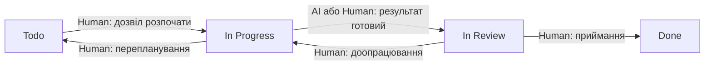

# Workflow — життєвий цикл задач

## Статуси GitHub Project

- **Todo** — задача ще не розпочата.
- **In Progress** — задача виконується.
- **In Review** — результат перевіряється.
- **Done** — результат прийнятий.

## Діаграма переходів

## Розподіл відповідальності

| Перехід | Відповідальний | Умова |
|---|---|---|
| Todo → In Progress | Human | Дозвіл на початок роботи |
| In Progress → In Review | AI / Human | Результат готовий |
| In Review → Done | Human | Критерії приймання виконані |
| In Review → In Progress | Human | Потрібне доопрацювання |
| In Progress → Todo | Human | Перепланування |

## Правило контролю

AI може готувати код, тести й документацію, але остаточне приймання виконує Human.
